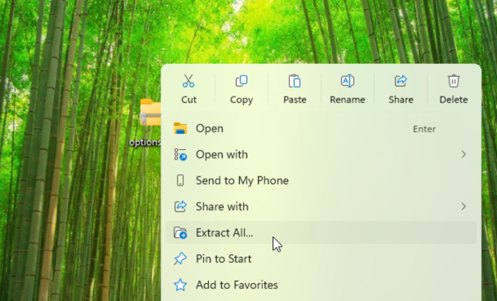
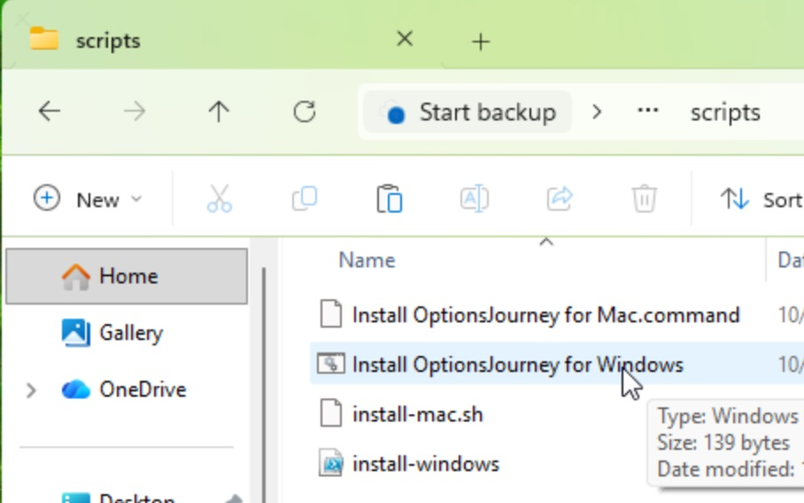
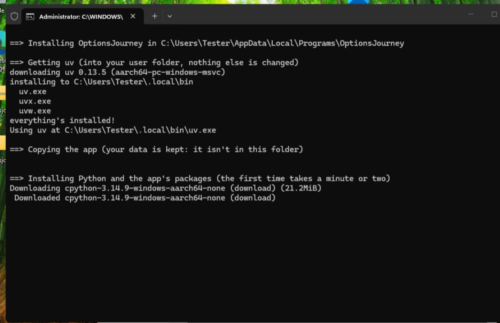
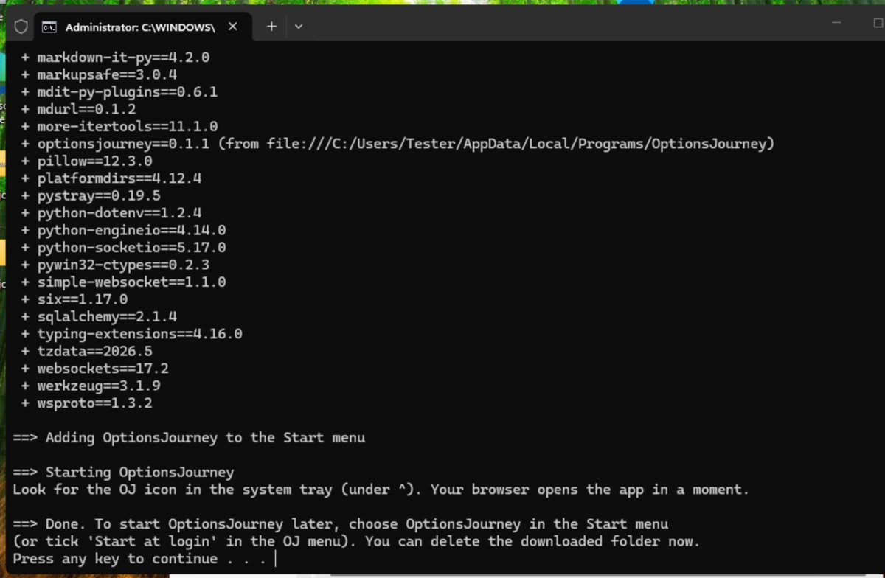
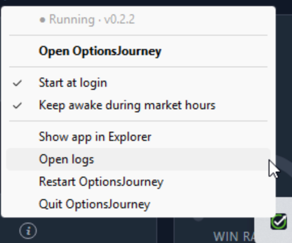
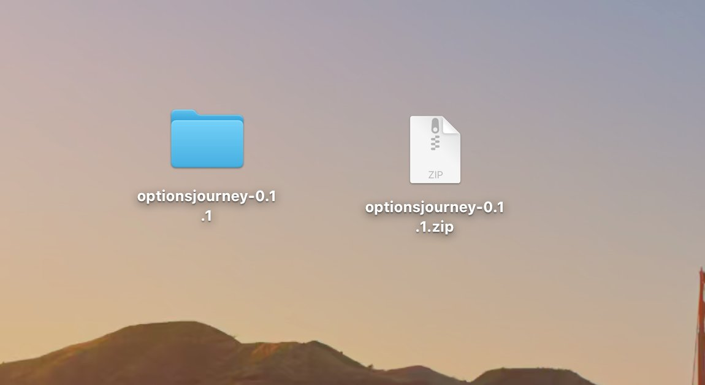
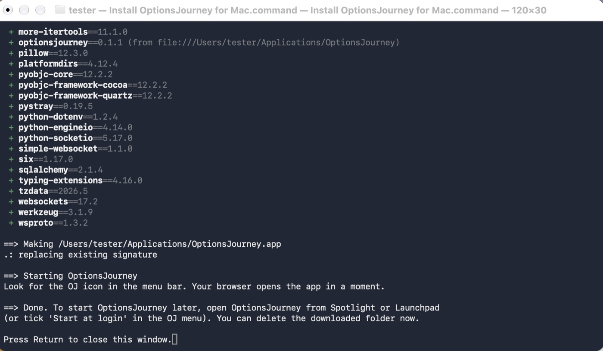
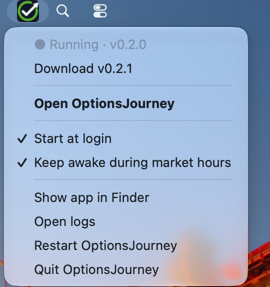

# Installing OptionsJourney

**Using Schwab?** Request your Schwab API app first: Schwab takes a few business days to approve it. See [Getting your broker API keys](broker-api-keys.md).

Download **[OptionsJourney.zip](https://github.com/optionsjourney/optionsjourney/releases/latest/download/OptionsJourney.zip)**. That link always gets the latest version. (It is also on the [Releases page](https://github.com/optionsjourney/optionsjourney/releases/latest), under **Assets**.)

## Windows
1. Open your **Downloads** folder, right-click the zip and choose **Extract All…**, then **Extract**.
   - Unzip it first. Double-clicking the zip only *shows* what's inside, and the installer can't run from there.

   
2. In the folder that opens, open **scripts** and double-click **Install OptionsJourney for Windows.bat**.
   - If Windows says "Windows protected your PC", click **More info**, then **Run anyway**.

   
3. A black window shows the progress. The first install downloads Python and takes a minute or two.

   
4. When it says **Done**, press any key to close the window. A green check-mark icon appears in the system tray at the bottom right (click **^** if you don't see it), and the app opens in your browser. The [setup guide](setup.md) takes it from there.

   

   Click the icon any time for the OJ menu:

   

The app is installed in your user folder (`AppData\Local\Programs\OptionsJourney`), so you can delete the zip and the extracted folder afterwards. To start it again later, choose **OptionsJourney** in the **Start menu**.

## Mac
1. Open your **Downloads** folder and double-click the zip to unzip it.

   
2. Open the new folder, then **scripts**, and double-click **Install OptionsJourney for Mac.command**.
   - Usually it just runs. If macOS says it "could not verify" the file or that it's from an unidentified developer, click **Done**, open **System Settings → Privacy & Security**, scroll down and click **Open Anyway** next to *Install OptionsJourney for Mac.command*, then confirm with your password. (On macOS 14 or older: right-click the file, choose **Open**, then **Open** again.)
   - If a box asks to install "command line developer tools", click **Cancel**: the app doesn't need them.
3. A Terminal window shows the progress. The first install downloads Python and takes a minute or two.
4. When it says **Done**, press Return to close the window. A green check-mark icon appears in the menu bar at the top right of the screen, and the app opens in your browser. The [setup guide](setup.md) takes it from there.

   

   Click the icon any time for the OJ menu:

   

The app is installed in `Applications/OptionsJourney` inside your home folder, so you can delete the zip and the unzipped folder afterwards. To start it again later, open **OptionsJourney** from Spotlight (⌘ Space) or Launchpad.

## Where things are
- **The app:** the folder above. **Show app in Finder / Explorer** in the OJ menu opens it.
- **Your data** (trades, bots, settings, backups) is kept separately, so updating or reinstalling the app never touches it: `AppData\Local\OptionsJourney` on Windows, `Library/Application Support/OptionsJourney` on a Mac.
  - **Moving it to another computer:** quit OptionsJourney first, then copy the whole folder. While the app is open, recent changes sit in files next to `optionsjourney.db` (ending `-wal` and `-shm`), so copying only that one file can lose them. A backup (Settings → Backups) is always a complete copy on its own.
  - **Keep it on this computer's own disk,** not in Dropbox, iCloud Drive, OneDrive or a network folder. Those can damage the database while the app is using it.
- **Logs:** a `logs` folder inside your data. **Open logs** in the OJ menu opens it.
- **Broker logins** are kept in the computer's own password store (Credential Manager on Windows, Keychain on a Mac).
