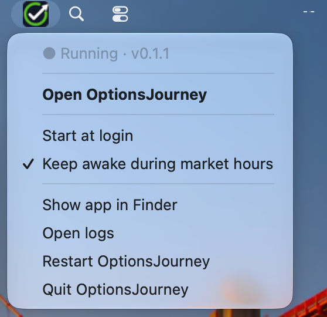
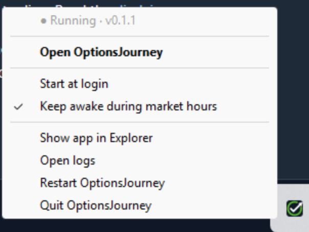

# The menu bar icon

OptionsJourney can run in the background with a small green check-mark icon in the menu bar (Mac) or system tray (Windows), so there's no window to keep open.

Click the icon to see:

 

- **● Running** and the version you have (for example **v0.1.2**), plus any alerts that need attention (for example "Schwab needs you to log in again");
- **Open OptionsJourney:** opens the app in your browser;
- **Open Alerts**, when there are some;
- **Start at login:** starts OptionsJourney whenever you log in to the computer;
- **Keep awake during market hours:** stops the computer going to sleep on weekdays from 9:15 to 4:15 New York time, so syncs (and later, bots) keep running. Also in Settings → This computer;
- **Download v0.2.1**, when a newer version is out. It becomes **Downloading v0.2.1…** while it downloads, then **Install v0.2.1…**, which opens a page that shows what is running and asks you to tick each box before it installs. See [Updating the app](updating.md);
- **Show app in Finder** (Mac) or **Show app in Explorer** (Windows): opens the folder the app is installed in;
- **Open logs:** opens the folder with the app's log file. If something goes wrong, send `optionsjourney.log` from there to [hello@optionsjourney.com](mailto:hello@optionsjourney.com);
- **Restart OptionsJourney:** quits and starts it again, for example after an error page;
- **Quit OptionsJourney.**

To start it again after quitting, open **OptionsJourney** from the Start menu (Windows), or from Spotlight or Launchpad (Mac). There's no window to keep open: the app runs in the background until you quit it.
